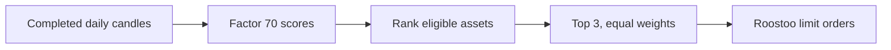
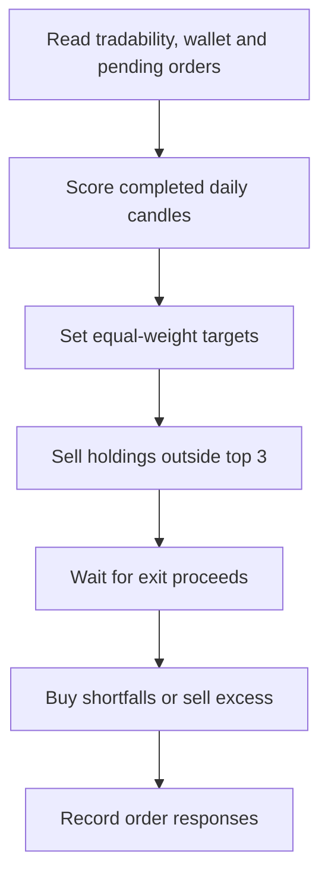
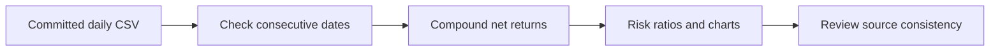

# 4ever1

### Systematic Crypto Trading · Roostoo Quant Trading Hackathon

*Factor 70 selection · Daily rebalancing · Spot execution*

## Overview

4ever1 uses Factor 70 to rank eligible assets each day, targets equal weights in the top three, and sends spot limit orders through Roostoo. Binance daily candles supply the live signal; Roostoo supplies tradability, quotes, balances, and execution.

## Mining Process

We mined candidate alpha factors with eight frameworks: AlphaEvolve, AlphaAgent, gplearn, FAMA, AutoAlpha, AlphaForge, AlphaGen, and AlphaQCM. Together they produced **1,064 candidate factors**. Each candidate was backtested over 2025 and January–September 2026. We then screened the candidates on four criteria:

- **Interpretability:** the formula has a clear economic meaning.
- **Robustness:** the result holds across sub-periods, nearby settings, and noisy labels (measured by PFS, see below).
- **Annualized return:** the backtested annualized return.
- **Competition fit:** the factor fits the competition's required medium-frequency strategy.

Factor 70 was the final selection. The mining code and the full candidate pool are not included in this repository.

## Factor Background

Factor 70 is a variant of Kaufman's Efficiency Ratio (KER, also called ER). KER measures how directly price moves over a window:

$$
ER_{t}=\frac{|C_{t}-C_{t-n}|}{\sum_{k=0}^{n-1}|C_{t-k}-C_{t-k-1}|}
$$

A value near 1 means price moved in a nearly straight line. A value near 0 means the move was mostly noise. KER is a trend indicator, and it is often used to set how fast an adaptive moving average reacts.

Factor 70 keeps the denominator but drops the absolute value in the numerator, so the sign shows direction as well as efficiency:

$$
F_{i,t}=\frac{C_{i,t}-C_{i,t-20}}{\sum_{k=0}^{19}|C_{i,t-k}-C_{i,t-k-1}|}
$$

Because the net move is never larger than the total path length, the score lies between −1 and +1. Positive scores mean a net gain over 20 days; negative scores mean a net loss. In backtesting, the signed variant paired with a suitable rebalancing rule produced attractive returns, even though KER was designed only as a trend gauge.

The [implementation](roostoo_bot/factor_strategy.py) needs 21 completed UTC daily closes, returns zero when the denominator is zero, and ranks higher scores first. Ties are broken by pair name. **Factor 70 is a ranking score, not a target price.**

## Factor Behavior

A high score requires a large 20-day net move that is not interrupted by many reversals. The top-ranked assets are therefore usually in a sustained uptrend. The strategy does not look for mean reversion. It tries to hold part of a trend that is already in progress. It can profit in two ways:

- **Riding a segment of the trend:** the asset is held while its score stays high and sold when the score falls.
- **Breakout continuation:** assets making new highs tend to score well, and large gains can follow a breakout.

## Strategy

Each day, after the prior UTC daily candle closes, the bot scores every eligible asset with Factor 70 and builds a three-name book. It holds those three at equal weight and reviews the book daily. The bot only takes long spot positions.

Four rules sit on top of the raw ranking:

- **Score floor (`FACTOR_MIN_SCORE`, default 0.30).** A pair is only eligible for a new slot when its factor is at or above this value. Rank alone is not a signal: on a quiet day the third-ranked name can still be weak, and buying it loses money.
- **Parabolic-move filter (`FACTOR_MAX_DAILY_GAIN`, default 0 — disabled).** A pair whose latest closed daily candle gained more than this fraction is excluded. A single parabolic day inflates the numerator of Factor 70, so an unfiltered ranking chases exactly the names that mean-revert hardest. Backtests on 2025-01 to 2026-10 showed every tested threshold between 15% and 50% *reduced* returns, so this rule ships off.
- **Sticky exit (`FACTOR_EXIT_REL_DROP`, default 0.45).** A held name is not sold merely for slipping down the ranking. It keeps its slot until its score falls more than this fraction below the score recorded at the previous rebalance; the remaining slots refill from the best eligible names. A name that was dropped is never re-admitted by the refill in the same cycle. When no baseline score exists (fresh state), the entry filters decide instead.
- **Intraday exit (`FACTOR_EXIT_REL_DROP`, every 30 minutes).** The same threshold is checked between rebalances. Each held name is re-scored with the last 20 completed daily closes plus the live price substituted for today's close — the identical window as the daily score, so the comparison is like-for-like. A drop of more than 45% against the recorded baseline submits a sell immediately. Entries are not touched intraday: a slot freed by an exit stays in cash until the next 08:00 HKT rebalance.

The book can be empty. When nothing clears the filters the portfolio goes to cash rather than holding a weak position overnight.

We tested top-N portfolios with N = 1, 2, 3, 4, and 5. N = 3 produced the best result, so it is the default (`FACTOR_TOP_N`).

## Trading workflow

The bot checks market and account state every 30 minutes. Normal factor rebalancing runs during 00:00–00:30 UTC (08:00–08:30 HKT), after the prior UTC daily candle closes.

The [engine](roostoo_bot/engine.py) quotes buys one tick below `MaxBid` and sells one tick above `MinAsk`, subject to exchange precision and minimum size. It skips pairs with pending orders and reserves a small USD buffer. Exits are submitted before entries and new buys wait for those exits to fill, because a resting Maker sell does not free USD. A rebalance that cannot be completed (underfunded slot or resting order) is retried up to six times before the day is closed. These are order limits, not predicted prices; orders may remain unfilled. The factor path has no per-asset take-profit or fixed stop-loss. Portfolio loss checks can pause rebalancing without liquidating positions.

## Backtest data and evaluation

The UTC 0 backtest produces 638 consecutive daily-return rows from **1 January 2025 through 30 September 2026**. The [daily return file](data/daily_top3_returns_2025_2026.csv) holds four strategy columns: `weekday_cash_top3`, `weekend_carry_top3`, `daily_top3`, and `baseline_77_equal`. Only `daily_top3` is the Factor 70 strategy reported here. The other two are variants, not the strategy in this README. The [daily holdings file](data/daily_top3_holdings_2025_2026.csv) lists the daily top-3 set, and the [annual returns file](data/annual_returns_2025_2026.csv) gives yearly figures. All returns are net of the 0.05% fee used in the backtest.

**Scope note.** The committed `daily_top3` series below is a plain daily top-3 rotation: no score floor, no sticky exit, no intraday monitoring. It is the original research result, not a simulation of the current code. The rules in [Strategy](#strategy) were added later and have **not** been re-backtested on a clean, complete dataset, so no return figure is claimed for them here.

The [CSV summary script](scripts/summarize_factor70_csv.py) recalculates the table and charts below from the `daily_top3` column. Total return is the product of `1 + daily net return`, minus one. Sharpe uses the daily mean divided by sample standard deviation, annualized by `√365`; Sortino uses downside root-mean-square below zero. Calmar divides annualized return by absolute maximum drawdown. All three use a zero risk-free/target rate. Drawdown resets at the start of each annual row; the full-period row uses one continuous equity curve.

| Period | Days | Net return | Max drawdown | Sharpe | Sortino | Calmar |
| --- | ---: | ---: | ---: | ---: | ---: | ---: |
| 2025 | 365 | +20.92% | −57.90% | 0.67 | 1.08 | 0.36 |
| Jan–Sep 2026 | 273 | +44.86% | −55.00% | 0.96 | 1.92 | 1.17 |
| Full period | 638 | +75.17% | −78.41% | 0.81 | 1.46 | 0.48 |

The equal-weight 77-asset baseline for each year is shown in the table under [Why the Backtest Starts in 2025](#why-the-backtest-starts-in-2025). Its daily returns and construction code are absent, so these baseline figures cannot be independently recalculated or compared on a matching daily risk basis.

### Why the Backtest Starts in 2025

The backtest covers 2025 and January–September 2026 only. We chose this window for two reasons:

- **Survivorship:** the 77 assets in the pool are those still trading today, so each has already survived the market. Testing a factor on earlier years of this pool would select the outcome first and then look for support in the past. That is hindsight, not out-of-sample evidence.
- **Data coverage:** many of the 77 assets had not been listed before 2025. Results for earlier years would rest on a changing and incomplete universe, which makes them less accurate.

The coverage counts below support the second reason.

| Year | Assets with data | Assets with complete data for the full year |
| --- | ---: | ---: |
| 2021 | 27 | 23 |
| 2022 | 28 | 27 |
| 2023 | 36 | 28 |
| 2024 | 45 | 36 |
| 2025 | 67 | 44 |
| 2026 (1 Jan–1 Oct) | 76 | 65 |

Equal-weight baseline returns for the same pool, by year:

| Year | Equal-weight baseline return |
| --- | ---: |
| 2025 | +8.56% |
| 2026 YTD (to 1 Oct) | +8.80% |

### Robustness Score (PFS)

PFS (Probabilistic Frequency Score) is the stability score used in AlphaEval. It measures whether a factor's cross-sectional ranking survives noise added to its labels. A score near 1 means the daily ranking barely changes under noise.

- **Relative noise:** the noise is multiplicative, `noisy = factor × (1 + noise)`, with one independent draw per (date, asset) cell. The noisy panel is then z-scored cross-sectionally each day.
- **PFS1:** Gaussian noise, `noise ~ N(0, σ²)`.
- **PFS2:** Student-t noise with 3 degrees of freedom, scaled as `t₃ × σ/√3` so its variance also equals σ². Both variants share the same variance; PFS2 has heavier tails and tests more extreme perturbations.
- **Noise level:** σ = √noise variance. The variance is 0.0423, computed from an equal-weight index of all 77 assets. Each asset is min-max normalized, the series are averaged with equal weights, and the result is normalized again. Its sample variance (ddof=1) gives σ ≈ 0.206. This is a methodology choice and differs from a CSI index basis.
- **Reproducibility:** the RNG seed is 20260925. Duplicate factors draw noise from different positions in the sequence, so their PFS values can differ slightly. IC and RankIC are unaffected.

| Score | Noise model | Value |
| --- | --- | ---: |
| PFS1 | Gaussian | 0.961 |
| PFS2 | Student-t (3 df) | 0.964 |

PFS is the time average of the daily cross-sectional correlation between the noisy factor and the clean factor. A value of 0.96 means the ranking stays highly correlated with the clean factor after roughly 20% relative noise is added.

PFS measures robustness to label noise. It does not measure predictive power or profitability; those are covered by the backtest table above.

The [PFS summary file](data/pfs_scores_2025_2026.csv) records both scores with their noise model, σ, seed, and asset universe. It holds only the two summary values, not daily PFS series.

## Limitations and Improvements

Factor 70 has the following known weaknesses:

- **Late entry:** a high score reflects moves that have already happened, so buying after a long run-up can mean buying near a top.
- **Slow exits:** a 20-day window reacts slowly, so an asset can fall a long way before it leaves the top three.
- **Concentration:** only three assets are held, so one sharp decline can hit a large share of the portfolio.
- **Outlier dependence:** a few large return days drive a material share of the 2026 result.
- **Drawdowns and exposure:** the full-period maximum drawdown is −78.41% (from 2025-11-07 peak to 2026-03-09), and the factor path has no per-asset stop-loss. The strategy can remain invested when all scores are negative.

The following improvements have not been validated:

- Add a trend filter, such as requiring price to sit above a longer moving average before buying.
- Exit when the factor score falls below a threshold, or when the score's own momentum turns negative, rather than waiting for the asset to drop out of the top three.
- Add a volatility-aware position cap or a trailing exit, and test it out of sample.
- Use walk-forward validation across the 2025 and 2026 periods instead of a single full-period backtest.

## References

- [Roostoo Quant Trading Hackathon](https://luma.com/coghwiyt)
- [Roostoo API documentation](https://github.com/roostoo/Roostoo-API-Documents)
