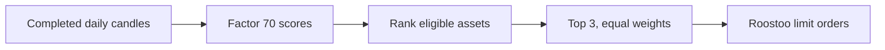
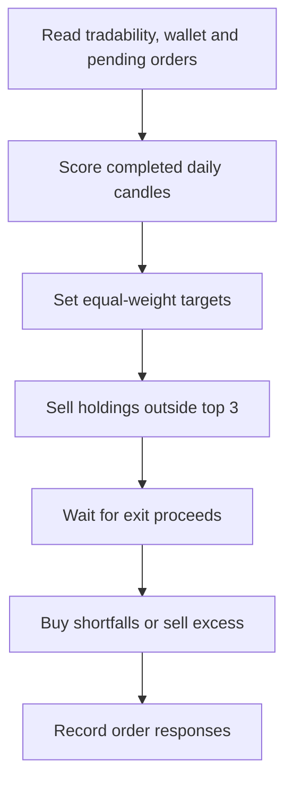
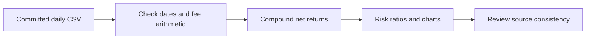
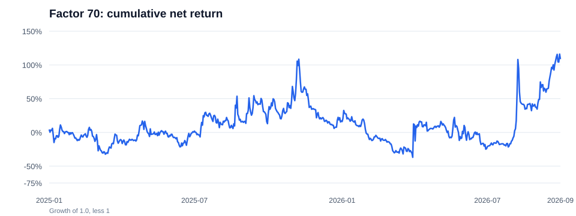
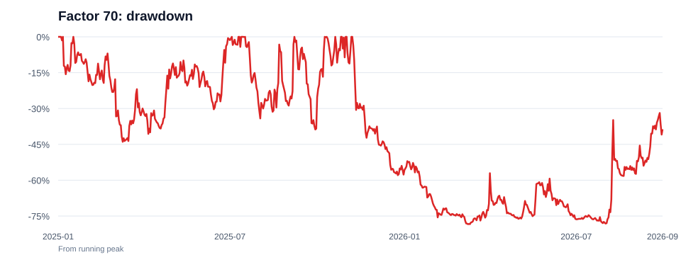

<div align="center">

# 4ever1

### Systematic Crypto Trading · Roostoo Quant Trading Hackathon

*Factor 70 selection · Daily rebalancing · Spot execution*


</div>

> **Backtest headline:** The committed daily-return CSV compounds to **+78.22% net from 1 January to 30 September 2026**. This is a historical simulation, not competition or live trading performance. Its source prices and generation code are not included, so the signal and fill history cannot yet be independently rebuilt.

## Overview

4ever1 uses Factor 70 to rank eligible assets each day, targets equal weights in the top three, and sends spot limit orders through Roostoo. Binance daily candles supply the live signal; Roostoo supplies tradability, quotes, balances, and execution.



## Factor 70 and selection

We selected Factor 70 during factor mining. It measures the direction of the net 20-day close change relative to the total absolute movement:

$$
F_{i,t}=\frac{C_{i,t}-C_{i,t-20}}{\sum_{k=0}^{19}|C_{i,t-k}-C_{i,t-k-1}|}.
$$

The [implementation](roostoo_bot/factor_strategy.py) needs 21 completed UTC daily closes, returns zero for a zero denominator, and ranks higher scores first. Ties use pair-name order. Up to three assets are selected even if all scores are negative. The bot only takes long spot positions. **Factor 70 is a ranking score, not a target price.**

The live candidate set must appear in `TRADING_PAIRS`, be marked `CanTrade` by Roostoo, and have enough Binance data. The committed [example configuration](roostoo_bot/config.py) lists only `BTC/USD,ETH/USD`; the bot does not automatically load every Roostoo pair. The actual competition pair list still needs to be recorded. The new annual baseline file lists 77 distinct assets across 2025–2026, but it does not establish that all 77 were tradable on every day.

## Trading workflow

The bot checks market and account state every 30 minutes. Normal factor rebalancing runs during 00:00–00:30 UTC (08:00–08:30 HKT), after the prior UTC daily candle closes.



The [engine](roostoo_bot/engine.py) quotes buys one tick below `MaxBid` and sells one tick above `MinAsk`, subject to exchange precision and minimum size. It skips pairs with pending orders and reserves a small USD buffer. These are order limits, not predicted prices; orders may remain unfilled. The factor path has no per-asset take-profit or fixed stop-loss. Portfolio loss checks can pause rebalancing without liquidating positions.

## Backtest data and evaluation

The latest commit adds 638 consecutive daily-return rows from **1 January 2025 through 30 September 2026**, plus daily holdings and annual summary CSVs. Each return row records a prior-day `signal_date`, gross return, absolute weight turnover, fee, net return, and holdings. The supplied fee equals **0.05% × absolute weight turnover** on every row.



The [CSV summary script](scripts/summarize_factor70_csv.py) recalculates the table and charts below. Total return is the product of `1 + daily net return`, minus one. Sharpe uses the daily mean divided by sample standard deviation, annualized by `√365`; Sortino uses downside root-mean-square below zero. Calmar divides annualized return by absolute maximum drawdown. All three use a zero risk-free/target rate. Drawdown resets at the start of each annual row; the full-period row uses one continuous equity curve.

| Period | Days | Net return | Max drawdown | Sharpe | Sortino | Calmar |
| --- | ---: | ---: | ---: | ---: | ---: | ---: |
| 2025 | 365 | +17.02% | −49.18% | 0.62 | 1.02 | 0.35 |
| Jan–Sep 2026 | 273 | +78.22% | −52.42% | 1.13 | 2.51 | 2.22 |
| Full period | 638 | +108.55% | −69.74% | 0.88 | 1.69 | 0.75 |





The [annual comparison file](data/annual_returns_2025_2026.csv) reports an equal-weight 77-asset baseline of **+2.73% in 2025** and **+4.35% in Jan–Sep 2026**. Its daily returns and construction code are absent, so these reported baseline figures cannot be independently recalculated or compared on a matching daily risk basis.

### Data checks that matter

- The [daily return rows](data/daily_top3_returns_2025_2026.csv) compound to **+17.02% for 2025**, matching the [Top 3 yearly file](data/daily_top3_yearly_2025_2026.csv). The annual comparison file instead lists **+14.59%** for that strategy and year. We use the daily-derived value above until the discrepancy is resolved.
- On **31 March 2026**, the CSV records a **+78.40% net day**. Removing only that day from the 2026 compounded series changes the period result from **+78.22% to −0.10%**. The headline is therefore highly sensitive to this observation, which requires raw-price and fill verification.
- The [daily holdings file](data/daily_top3_holdings_2025_2026.csv) differs from the return file on **29 September 2025**: it lists three assets while the return row lists two. The 77-asset annual file contains 67 asset-year rows for 2025 and 76 for 2026.

These checks validate arithmetic within the supplied daily CSV. They do not prove that the holdings follow Factor 70, that all assets were available at each signal time, or that simulated fills match Roostoo execution. The older [24 × 15-day script](scripts/factor_sliced_backtest.py) has a different output format and is not identified as the generator of these new CSVs.

## Run and reproduce

Requires Python 3.10 or newer. From the repository root:

```bash
python3 -m venv .venv
source .venv/bin/activate
python -m pip install -r requirements.txt
cp .env.example .env
python main.py demo
```

`demo` uses synthetic data and sends no orders. `python main.py paper` uses public Binance data with simulated orders. `python main.py run --live` requires Roostoo credentials and can submit real orders. Set `TRADING_PAIRS` in `.env` to the intended live universe.

Recalculate the CSV-derived statistics and charts:

```bash
python scripts/summarize_factor70_csv.py
```

To reproduce the **underlying backtest**, the repository still needs the historical price source, universe and availability rules, signal-generation code, fill assumptions, and a command that generates the committed daily CSV from raw inputs. Until then, the return figures should be read as results supplied in this repository, not an independently reproduced strategy test.

## References

- [Roostoo Quant Trading Hackathon](https://luma.com/coghwiyt)
- [Roostoo API documentation](https://github.com/roostoo/Roostoo-API-Documents)
